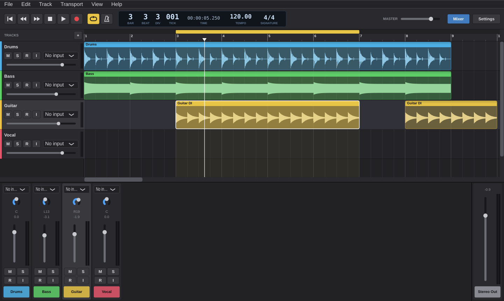

# Tracklayer

A small Logic-style multitrack recorder for Windows and Mac, written in C++ with [JUCE](https://juce.com).



## What it does (v0.2)

- **Arrange window**: tracks with coloured regions and waveforms, bar ruler, beat grid, snapping, zoom.
- **Recording**: arm any number of tracks (R), pick a mono or stereo input per track, and press R to record. The app compensates for latency automatically, and recordings are saved as 24-bit WAVs in the project's `Audio` folder.
- **Input monitoring** (I) so you can hear yourself through the track.
- **Editing**: drag regions (between tracks too), trim either edge, split at the playhead (Ctrl+T), delete. Hold Alt to drag without snapping.
- **Cycle mode**: drag in the yellow strip at the top of the ruler and click it to toggle, like Logic.
- **Metronome**, tempo (drag or double-click the LCD), and a bars/beats/div/tick display.
- **Mixer** (X): faders, pan, mute/solo, peak meters, Stereo Out.
- **Plugins**: VST3 on Windows and Mac, plus Audio Units on Mac. Each track has six Audio FX insert slots on its mixer strip: click an empty slot to add an effect, click it again to open its window, right-click to bypass, replace or remove it. Plugin settings are saved in the project. Find your plugins with **File → Plugin Manager → Scan / Options → Scan for new or updated VST3 plug-ins**.
- **Import** WAV, AIFF, FLAC, Ogg and MP3 files by drag-and-drop from Explorer or with Ctrl+I.
- **Bounce** the mix to a 24-bit WAV with Ctrl+B.
- **Save and open** `.tlproj` projects, which are plain JSON and point at the audio files.

## Building it

### Option A: let GitHub build it (no software to install)

1. Create a new GitHub repository and upload this folder to it.
2. Open the **Actions** tab. The "Build" workflow runs automatically, or you can start it with **Run workflow**.
3. When it finishes (about 10–15 minutes), download **Tracklayer-Windows** or **Tracklayer-Mac** from the run's Artifacts.

The Mac app isn't signed, so the first time, right-click it and choose **Open**, then **Open** again.

### Option B: build it on a Mac

1. Install the Apple build tools in Terminal: `xcode-select --install`
2. Install [Homebrew](https://brew.sh), then run `brew install cmake`
3. In Terminal, `cd` to this folder and run `bash build-mac.sh`
4. `Tracklayer.app` appears in this folder. Drag it to Applications if you like.

### Option C: build it on a Windows PC

1. Install [Visual Studio 2022 Community](https://visualstudio.microsoft.com/vs/community/) with the **Desktop development with C++** workload.
2. Open the **Developer Command Prompt for VS 2022**, `cd` to this folder, and run `build-windows.bat`.
   The first build downloads JUCE and takes a while.
3. `Tracklayer.exe` appears in this folder.

To work on the code, open the folder in Visual Studio (File → Open → Folder). It picks up the CMake project automatically.

## Try it

Open `Demo/Demo.tlproj` (File → Open, or drag it onto `Tracklayer.exe`) for a short drums, bass and guitar sketch.

## Audio setup

Open **Settings** (Ctrl+,) and pick your interface. Use **Windows Audio (Exclusive Mode)** or **Low Latency Mode** for the lowest latency. Enable the input channels you want to record from.

For **ASIO**: download the Steinberg ASIO SDK, then build with `build-windows.bat -DASIO_SDK_DIR=C:\path\to\asiosdk`.

## Keyboard shortcuts (Logic-style)

| Key | Action |
|---|---|
| Space | Play / Stop |
| R | Record |
| C | Cycle on/off |
| K | Metronome |
| Return | Go to beginning |
| , / . | Back / forward one bar |
| X | Mixer |
| Z | Zoom to fit (Ctrl+wheel or Ctrl+←/→ to zoom) |
| Ctrl+T | Split region at playhead |
| Delete | Delete region |
| Ctrl+Alt+N | New track |
| Ctrl+I | Import audio |
| Ctrl+B | Bounce mix |
| Ctrl+S / Ctrl+O / Ctrl+N | Save / Open / New |

## Command line

```
Tracklayer.exe "My Song.tlproj"                        open a project
Tracklayer.exe --bounce "My Song.tlproj" "Mix.wav"     render without opening the window
```

## Roadmap

1. Undo/redo
2. Built-in amp slot for TONE3000 / NAM captures and cab IRs
3. MIDI tracks: piano roll, MIDI input, instrument plugins
4. Plugin latency compensation, sends, buses and automation
5. Importing Logic projects: stems and MIDI first, then AAF, then reading `.logicx` directly

## Licence note

JUCE is free for personal use under its personal licence or AGPLv3. Check the JUCE licence before distributing builds commercially.
